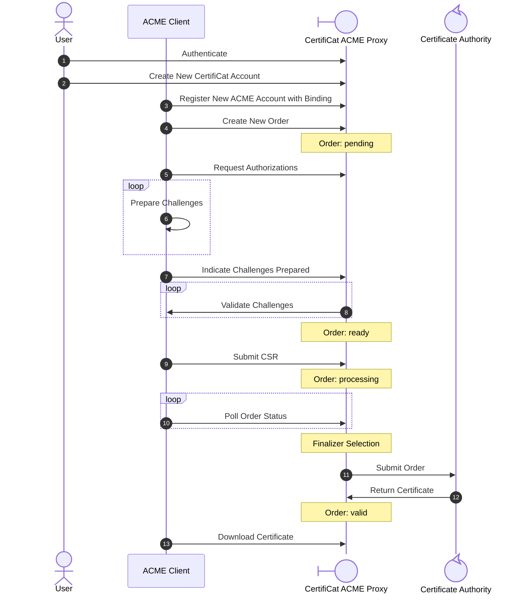

# Features

An ACME order transaction consists of three parties.

- **ACME client**: Creates the CSR and may control reloading services when the certificate is downloaded.
- **CertifiCat**: Answers requests from the ACME client and proxies the CSR to an upstream authority.
- **Certificate Authority**: The service ultimately responsible for processing the CSR and creating a certificate.

The following diagram illustrates the ideal path for an ACME transaction including new account creation. CertifiCat ACME features are grouped and documented by how they extend and support the ACME protocol.

